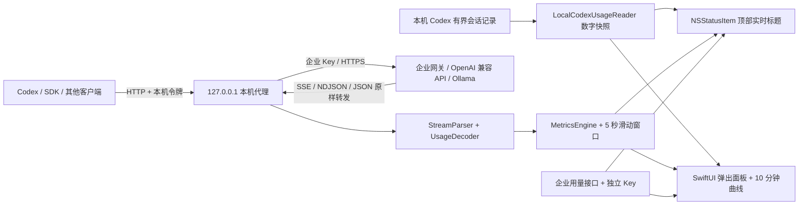

# TokenStatMenu

原生 macOS 菜单栏 Token 监控器。Swift + SwiftUI / AppKit；macOS 13+；Apple Silicon 与 Intel；正式 App 无第三方运行时依赖、无 Electron、无主窗口。开发侧 UI 测试单独使用 SnapshotTesting。

默认读取本机 Codex 有界范围内最多 32 个物理记录文件，无需 API Key、不修改 Codex 配置。通过首条会话 metadata 识别逻辑线程，能证明继承边界时扣除分叉继承量；无法核算的线程和无法识别的文件单独报告。菜单栏显示上轮记录均速、已知记录小计和有证据的顶层对话数量。仅当有完整轮次边界和累计用量证据时计算均速，缺失时显示 `上轮均:—`；它包含工具、网络和等待，不是模型瞬时生成速度。本地额度无论记录多新，都只显示历史参考及原始已用比例、记录时间和重置时间；不显示企业当前剩余额度，也不触发企业额度告警。账号和组织归属未经核验。

切换到可选的代理模式后，菜单栏尚未采集请求时显示 `T:—`，采集过请求且当前空闲时显示 `T:0.0tok/s`，请求进行中显示例如 `T:≈24.5tok/s`。`≈` 明确表示实时文本估算；最后收到权威 `usage` 后，启动以来的累计用量与估算费用会校正。菜单标题还会附带启动以来的累计 Token 和请求数，例如 `T:≈24.5tok/s · Σ1.2M · 请求8`。没有请求经过代理时不会产生速度数字。

菜单栏本机模式只在扫描未达上限、且所有纳入记录均可核算时显示 `Σ`；否则有已知值时显示 `小计` 和 `未核验` 数量，无已知值时显示 `Σ—`。这些数值都只是当前扫描范围的来源记录量，既不是本次启动增量，也不是账户全历史消耗或企业账单。顶层对话、子代理和分叉分类依赖 metadata，不以文件数冒充会话数；悬停可查看分类、未核算项和范围说明。代理模式显示输出估算速度、启动以来累计与请求数。菜单栏可用空间由 macOS 决定，图标较多或刘海屏可能压缩显示空间。

本机速度采用同一文件内已完成轮次的记录输出增量除以轮次时长，优先合法 `duration_ms`，缺省时才使用开始/完成事件时间。只使用轮次内部更新，不挪用结束后的记录；中止、计数回退、错位或缺失计时证据均不生成速率。最近一个有效完成轮次可继续展示，面板标明时间，不冒充正在生成的当前速度。[Codex 官方记录策略](https://github.com/openai/codex/blob/main/codex-rs/rollout/src/policy.rs)说明本地记录与实时消息流有区别。

## 整体架构



本机记录模式与代理模式分别显示数据，不混合累计。企业额度的全自动接入仍未完成；本机记录也不提供逐 Token 的实时流，不应将本轮计量修复理解为已实现自动企业额度或瞬时速度。代理模式用于观测实际流式请求，因为应用无法凭空读取其他进程的 TLS 流；它不修改系统代理，也不自动修改 Codex 或企业客户端配置。代理统计只覆盖启动后经过它的请求。

## 文件与职责

| 文件 | 职责 |
|---|---|
| `Sources/TokenStatCore/LocalCodexUsageReader.swift` | 有界只读本机计量记录、会话去重、独立额度快照 |
| `Sources/TokenStatCore/GatewayDiscovery.swift` | 本机配置白名单读取、网关候选、凭据 URL 拒绝 |
| `Sources/TokenStatCore/Configuration.swift` | Endpoint、价格、配额、URL 校验、上游路径映射 |
| `Sources/TokenStatCore/HTTPDecoder.swift` | HTTP Content-Length/chunked 请求解码与边界校验 |
| `Sources/TokenStatCore/ProxyServer.swift` | 回环监听、认证、URLSession 增量转发、取消、背压 |
| `Sources/TokenStatCore/StreamParser.swift` | SSE/NDJSON 分帧、Chat/Responses/Ollama usage、文本估算 |
| `Sources/TokenStatCore/RateWindow.swift` | 单调时钟下的 5 秒窗口、100ms 分桶 |
| `Sources/TokenStatCore/MetricsEngine.swift` | 并发隔离、累计校正、费用、请求成功/失败与延迟 |
| `Sources/TokenStatCore/Quota.swift` | 企业 JSON 字段路径、月份、配额计算 |
| `Sources/TokenStatCore/WindowQuota.swift` | 独立的月度、5 小时与 7 天额度解析和过期状态 |
| `Sources/TokenStatMenu/TokenStatMenuApp.swift` | App 生命周期、LSUIElement 菜单栏启动 |
| `Sources/TokenStatMenu/StatusBarController.swift` | 持有 NSStatusItem、2Hz 标题刷新、颜色告警与 NSPopover |
| `Sources/TokenStatMenu/AppModel.swift` | UI 状态、限频刷新、服务管理、日志导出 |
| `Sources/TokenStatMenu/DashboardView.swift` | 中文实时/累计/费用/配额/请求/历史图面板 |
| `Sources/TokenStatMenu/SettingsView.swift` | 内嵌设置面板，无独立主窗口 |
| `Sources/TokenStatMenu/Storage.swift` | plist、专用 Keychain、脱敏 JSONL 日志与轮转 |
| `Sources/TokenStatMenu/QuotaClient.swift` | 独立 GET 用量请求、超时、重定向拒绝 |
| `Resources/Info.plist` | 菜单栏 App 元数据 |
| `Resources/config.example.plist` | 无需改代码的配置样例 |
| `Tests/TokenStatCoreTests/CoreChecks.swift` | 无 XCTest 依赖的核心测试 |
| `script/integration.py`、`mock_server.py` | 实际 `.app` 与本地模拟上游联测 |

所有源码均为完整文件。另见 `docs/FULL_SOURCE.md`：按“架构 → 分文件完整源码 → 构建与使用”排列的单文件交付版。

## 构建与运行

### Xcode

1. 完成 Xcode 首次启动、许可与组件安装。
2. 打开 `TokenStatMenu.xcodeproj`，选择 **TokenStatMenu → My Mac**。
3. 按 ⌘B 编译，⌘R 运行。程序只出现于菜单栏，不会打开主窗口或 Dock 图标。
4. 项目默认本机 ad hoc 签名；向其他电脑正式分发时，使用你的 Developer ID 签名与公证。

`.xcodeproj` 和 Swift Package 编译同一份源码。新增源码后执行 `python3 script/generate_xcode_project.py` 可更新 Xcode 项目文件。

### 命令行（Command Line Tools 即可）

```bash
git clone https://github.com/Tupig/TokenStatMenu.git
cd TokenStatMenu
./script/build_and_run.sh                 # 构建 .app 并启动
./script/build_and_run.sh --build-only    # 仅生成 dist/TokenStatMenu.app
./script/build_and_run.sh --release       # 本机架构优化构建并启动
./script/build_and_run.sh --universal     # arm64 + x86_64 Release；只构建不启动
```

可将 `dist/TokenStatMenu.app` 拖到“应用程序”。开发脚本会先关闭同名进程再更新构建产物，避免覆盖正在执行的二进制。不会自动设置开机启动。

当前 Swift 6.4 对 `--build-system native` 有弃用提示；采用它是为了兼容这台机器已经可用的 Command Line Tools。项目不依赖该构建系统，Xcode 项目仍可独立编译。

## 首次配置与接入

首次启动默认使用本机 Codex 记录：每次后台扫描完成后等待 5 秒再扫描，未变化文件仅校验元数据并复用内存中的数值摘要，只枚举已知 sessions 目录内最多 5,000 个目录项，在枚举范围按修改时间排序选取最多 32 个物理文件；不是整个账户最新 32 个对话的保证。每文件读取头部最多 64 KiB 与尾部最多 256 KiB，重叠不重复读取，单次总量最多 10 MiB。没有有效计量事件时显示未知，不把缺失当作零。未配置的新安装使用本机来源；已有明确代理配置保持代理模式。

以下步骤用于需要流式速度估算的**代理模式**，先在设置中切换数据来源：

1. 点击菜单栏统计文字 → **设置**。
2. 设置页会自动发现本机 Codex 配置中的网关；核对来源后点“填入”。也可手动填写上游完整 Endpoint，例如 `https://你的网关/v1/chat/completions`；填写企业推理 API Key。Ollama 本机无需 Key。
3. 模型覆盖留空时使用客户端请求的 `model`；填写时会覆盖所有经过代理请求的模型。
4. 保存设置，回到面板，分别复制 **Base URL** 与 **本机令牌**。
5. 将调用方 Base URL 改成 `http://127.0.0.1:18765/v1`，调用方 API Key 使用本机令牌。企业真实 Key 保存在本 App 的钥匙串中。
6. 发起流式请求；菜单栏显示输出估算速度。请求结束后立即回到 `0.0`，累计数量以末尾 usage 校正。

示例（把 `本机令牌` 和 `模型名` 换成实际值）：

```bash
curl -N http://127.0.0.1:18765/v1/chat/completions \
  -H 'Authorization: Bearer 本机令牌' \
  -H 'Content-Type: application/json' \
  -d '{"model":"模型名","stream":true,"messages":[{"role":"user","content":"请介绍一下你自己"}]}'
```

支持的本机请求路径：

- `POST /v1/chat/completions`：OpenAI Chat SSE 或非流式 JSON。
- `POST /v1/responses`：Responses 文本、推理摘要、工具参数 delta 与嵌套 usage。
- `POST /api/chat`、`POST /api/generate`：Ollama 原生 NDJSON / JSON。
- `GET /health`：仅返回进程健康，不需要令牌。
- `GET /tokenstat/status`：需要本机令牌；返回累计与实时统计 JSON。

上游 URL 会保留 Endpoint 的前缀，再替换以上路由后缀。例如设置 `https://gateway.example/gateway/v1/chat/completions`，Responses 请求发往 `https://gateway.example/gateway/v1/responses`。不支持通用 CONNECT、WebSocket、未知路径、自动 SDK 模型枚举或 TLS 透明拦截。

Codex 如使用 Responses，需要通过其受支持的自定义 provider 配置将请求接入本机 `/v1`。企业客户端可能自行覆盖配置或使用额外认证，必须按该客户端接入方式处理。本项目没有更改你现在的 Codex 或企业网关配置。

## 关键计算口径

### 本机记录身份与计量范围

- 逻辑线程身份来自文件第一条完整 `session_meta.payload.id`，不使用文件名尾部 UUID：同一线程的不同 rollout 文件可能有不同文件名。祖先 metadata 不覆盖首条身份。
- 同 inode 或能在预算内证明全文一致的副本只计一次；同一线程存在内容冲突或无法完整比较的版本时，整组标为未核算，不按修改时间猜哪份正确。
- 根线程使用最后有效累计作为来源记录量。它可能受上游上下文处理影响，不是企业计费流水。最后明确累计损坏时不会偷偷采用旧值。
- 复制式分叉只在初始化边界、继承基线及最终累计间的记录完整连续时，逐项计算输入、输出、总量的差。缺失、回退、越界或中间未读取时标为未核算。引用式父历史目前未核算，不减去父线程当前总量，也不把子线程继承量重复加入。
- 小计保留可核算线程的值，未知项不会当作零。达到扫描上限时也不显示成完整 `Σ`。这些限制会导致无法提供完整历史总量，界面会如实说明。
- `rate_limits` 缺失或为 `null` 表示没有新的额度证据，不清除已读范围内的历史快照；合法显式空对象 `{}` 清除，合法非空窗口对象整体替换，不补接其他事件的窗口。异常对象被拒绝。本地记录没有提供的 5 小时窗口仍是未知。

### SSE 与 Token 计数

HTTP 网络 chunk 与模型 token 不一一对应。`StreamParser` 保存未完整行的原始字节，按 LF/CRLF 提取行，多行 `data:` 合并，空行结束事件，忽略注释。中文 UTF-8 拆到不同网络回调也不会破坏字符。单事件限制约 2MB。

`UsageDecoder` 读取文本、推理文本和工具参数增量。无模型 tokenizer 时，ASCII 标量暂按 0.25 token、非 ASCII 按 1 token 估算；这是明确的启发式估算，不是精确 BPE。累计原始权重后再取整，避免“每个 chunk 至少算一个 token”的偏差。图像/音频等非文本输入不能靠文本准确估算。

Chat 的 `usage.prompt_tokens/completion_tokens`、Responses 的 `response.usage.input_tokens/output_tokens`、Ollama 的 `prompt_eval_count/eval_count` 到达后替换该请求累计值。重复 usage 不重复累加，reasoning 已含在上游输出 token 中时也不重复相加。没有 usage 的完成/失败请求保留估算标记。

OpenAI 兼容网关可能拒绝 `stream_options.include_usage`；可在设置关闭该开关。这会降低最终统计准确度，除非上游仍返回用量。

### token/s 滑动窗口

使用 `ProcessInfo.systemUptime` 避免系统时间回拨影响。输出估算增量进入 100ms 分桶，保留最近 5 秒：

`输出估算 tok/s = 最近 5 秒输出估算增量总和 ÷ 5`

启动最初不足 5 秒仍除以 5，因此读数渐进升高；这是固定窗口平均，非瞬时 token 间隔测速。并发请求的输出合计显示。末尾 usage 的校正差值不进入滑动窗口，避免结算时出现假峰值；没有活跃请求时标题归零。

输入没有逐块生成事件，面板显示 `输入 Token ÷ 从请求开始到首个输出片段的时间`，明确标记“推算”。等待首输出时使用已等待时间，实时显示的分母最低取 0.5 秒以避免启动瞬间产生极大值。它包含网络和排队，不能当作模型实际 prefill 速度。Ollama 返回 `prompt_eval_duration/eval_duration` 时，另显示上次服务端平均输入/输出速度（纳秒换算为秒）。

### 刷新、成本与配额

- 菜单栏 2Hz，只有标题或颜色变化时改 attributedTitle；网络回调不直接绘制 UI。
- 曲线 1Hz、最多 600 点；仅弹出面板可见时构建图表，不使用高频动画。
- 请求、网络、日志使用后台串行队列；统计引擎短锁保护并发，没有锁内 I/O。
- 输入/输出单价按 **USD/百万 Token** 保存；CNY 只是用手填汇率换算显示。每请求记录开始时单价，之后改价不会改写历史费用。
- 费用不是企业账单；缓存输入按普通输入价，失败请求缺失 usage 时也可能有估算费用。
- 企业配额来自独立接口；手填总量仅定义上限，没有接口就显示已用/剩余/使用率未知。
- 月度映射字段 `usedPath` / `limitPath` 是 Token 数量；5 小时与 7 天映射字段分别是 0–100 的 `used_percent`，重置时间可用 Unix 秒或 ISO 8601。也接受同一接口中的 Codex `rateLimits` 格式，并按 300 / 10080 分钟识别窗口；窗口缺失或过期时显示未提供/过期，不从月度配额或本机 Token 推算。详见 [配置说明](docs/CONFIGURATION.md)。
- 仅配置接口提供且仍有效的配额达到 80% 时标题黄色、95% 红色，不发通知或弹窗；本地历史快照、过期或异常时间数据不驱动企业额度告警。

## 本机网关自动发现与隐私

本机记录模式仅扫描 `$CODEX_HOME/sessions`（未设置则 `~/.codex/sessions`）。扫描有文件数、枚举数和字节上限，拒绝符号链接；只保留计量数值、时间及扫描状态。会话文件可能含有正文，因此有界读取头部与尾部会短暂接触这些字节，但不会保留、导出或上传正文。仅在内存缓存受限的身份/摘要与计量数值，以验证去重和读取变化；这些标识不进入公开快照或日志。本机模式不读取认证文件或钥匙串，也不启动代理或访问配额接口。

代理模式的网关发现会在启动时及点击“重新扫描”时读取 `$CODEX_HOME/config.toml`（未设置则 `~/.codex/config.toml`），只提取 `model`、`model_provider`、`profile` 以及 provider 的 `base_url`、`wire_api`。支持常见的单行字符串 TOML 与活动 profile；不支持的复杂形式不猜测、不导入。配置文件限制 1MB，不做目录递归扫描。

也识别当前进程中的 `OPENAI_BASE_URL`、`OPENAI_MODEL`、`OLLAMA_HOST`；从 Finder 启动时不一定继承终端环境。不会执行 shell 配置文件。企业客户端只要把自定义 provider 写入上述 Codex 配置，就能通过同一机制被发现；不需要硬编码公司名称或网关域名。

发现结果仅在本机内存和设置页展示，不联网验证，不写入统计日志。点击“填入”后仍需保存；更换 Endpoint 会清空表单中的旧推理/配额密钥及旧用量 URL，避免将旧凭据发给新上游。带 URL 用户名、密码、查询参数或 fragment 的候选整条拒绝导入。认证文件、浏览器数据、其他应用钥匙串和企业后台数据库均不属于发现范围。

发现网关地址不等于认证成功，也不自动接管 Codex 流量。需要认证时，用户仍须通过设置提供自己有权使用的 API Key。项目自己的密钥保存在专用 Keychain 中，并按用途与完整接口 URL 分别绑定；更换接口不会自动复用其他地址的密钥。旧版未绑定地址的密钥不会自动迁移，代理模式需要重新填写；本机记录模式不需要密钥。完整数据处理说明见 [PRIVACY.md](PRIVACY.md)。

企业月度接口通常与推理接口不同；本项目不会猜测计费 URL 或把金额/积分当作 Token。需配置企业文档确认的接口与字段，详见 [配置说明](docs/CONFIGURATION.md)。

## 验证与限制

```bash
./script/test.sh
# 只运行核心检查：
swift run --build-system native TokenStatCoreChecks
```

测试会关闭当前 TokenStatMenu，运行隔离本地配置，使用纯测试令牌；不会访问企业网关。测试通过 `--test-fixture` 参数显式启动，菜单栏加“测试”前缀，面板常显橙色“模拟测试”标记。正常启动尚无流量时显示“未采集”，累计量为 `—`；存在估算请求时累计量带 `≈`。默认结束后关闭测试 App 和 mock 服务。可用 `python3 script/integration.py --keep-running` 保留测试面板作检查，注意面板里都是模拟数据。

测试报告见 `docs/VALIDATION.md`。核心测试是可执行程序，保留仅使用 Command Line Tools 的运行方式。

### UI 视觉回归

已接入 [SnapshotTesting](https://github.com/pointfreeco/swift-snapshot-testing) 1.19.6（MIT），版本和传递依赖记录在 `Package.resolved`。它只属于 SwiftPM 测试目标，正式菜单栏 App 不链接测试库。使用完整 Xcode 运行：

```bash
DEVELOPER_DIR=/Applications/Xcode.app/Contents/Developer swift test --filter TokenStatUISnapshotTests
```

测试比较真实 SwiftUI 工具栏的浅色、深色及设置状态，共四张已审查的合成参考图。正常测试禁止录制，缺图或图像变化即失败；参考图更新命令见 [UI 测试说明](docs/UI_TESTING.md)。像素参考图要求一致的 macOS 与显示缩放环境；CI 运行不依赖系统外观的校验，桌面视觉比较单独执行。图像快照不等于实际弹出面板的键盘焦点、点击或辅助功能验收。

常见情况：

- **均速一直 —**：本机模式需要在同一有界尾部中找到开始前累计、匹配的轮次开始、轮内用量更新与正常完成。缺少其中任何一项时不计算；历史导入量和扫描间隔不会用来伪造速度。代理模式需确认请求确实经过本机代理并使用本机令牌。
- **5 小时没有数据**：只有来源确实提供 300 分钟窗口才能显示。7 天窗口不能换算成 5 小时，企业网关也未必具有官方订阅额度。面板区分来源未提供、历史快照、时间异常和重置时间已过；历史原值不会触发当前额度告警。
- **企业配额未知**：本机来源只显示历史额度参考，记录新鲜也不能证明它属于当前企业账号或限额池。代理来源需检查用量 URL、独立 Key、字段路径和月份；推理 API 的 Key 不一定能访问计费接口。自动发现推理网关地址不等于接通企业额度接口。本项目当前月度字段按 Token 解释，不能直接填写金额字段。
- **图标不见**：macOS 可能关闭菜单栏项目或因刘海/其他图标拥挤而隐藏，任何 App 都不能保证绕过系统布局。检查“系统设置 → 菜单栏”。从 Finder 再次打开应用会主动打开面板。
- **关闭面板即退出**：本项目持有 status item 和 app delegate，并显式禁止最后窗口关闭时退出。
- **内存/CPU**：使用原生框架、有限缓冲与低频刷新，不会无限保存回答文本；SwiftUI/Charts 仍有系统开销，不承诺所有机器固定内存值。
- **代理断开**：App 退出后代理端口停止，调用方需恢复原 Endpoint 才能直接访问上游。
- **Xcode 报许可错误**：手动首次打开 Xcode 完成其许可流程。本项目脚本不代替用户接受协议。

纯测试数据必须显式附加 `--test-fixture`，此参数仅标记来源，不会自行生成数据。调试可显式附加 `--show-panel` 和 `--diagnostics-output /tmp/tokenstat-status.json`，后者每秒输出实际 AppKit 标题、popover 状态和用量摘要，不含密钥/请求正文。正常运行没有诊断文件写入。

## 上游格式参考

- [OpenAI Chat API](https://developers.openai.com/api/reference/resources/chat)
- [OpenAI Responses 流事件](https://developers.openai.com/api/reference/resources/responses/streaming-events)
- [Ollama Chat API](https://docs.ollama.com/api/chat)
- [Apple NWListener](https://developer.apple.com/documentation/network/nwlistener)

## 开源

[MIT License](LICENSE)。发现的问题应建立 GitHub Issue，并用虚构域名、模型名与脱敏数据描述复现步骤；Issue 应链接对应修复与验证结果。请勿提交真实企业配置、凭据或日志。欢迎提交 Pull Request。

发布前执行 `python3 script/package_source.py` 重新生成完整源码与源码包，再执行 `python3 script/check_public_content.py` 检查发布清单。Git 提交前使用 `--git-index` 检查实际暂存内容，并人工审查差异；检查脚本不会连接外部服务。

## 界面设计参考

视觉布局参考 [codexU](https://github.com/shanggqm/codexU) 的紧凑圆角卡片、半透明材质与蓝紫色强调。TokenStatMenu 的界面组件独立用 SwiftUI 实现，未复制其源码、图标、截图或配色资源。

离线界面预览：`python3 script/render_preview.py`，在 `dist/previews` 生成浅色/深色概览与设置页图片。预览明确标记模拟数据，使用独立内存模型，不读取本机配置或 Keychain、不发网络请求。
