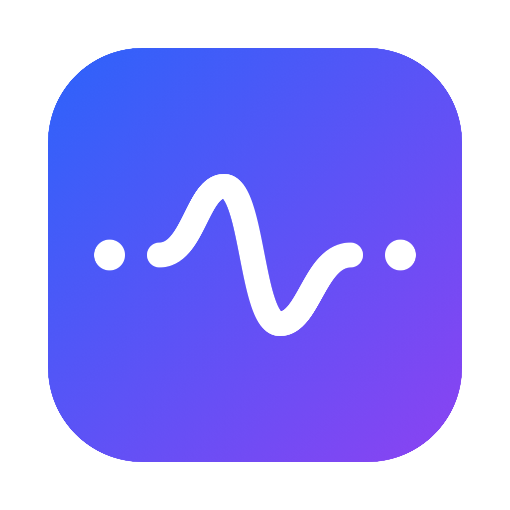

# TokenStatMenu

[](https://github.com/Tupig/TokenStatMenu/actions/workflows/ci.yml)
[](https://github.com/Tupig/TokenStatMenu/releases)
[](LICENSE)
[](#安装)
[](#编译)

**简体中文** | [English](#tokenstatmenu-english)



在 macOS 菜单栏查看 **Seasun Token Hub** 的 5 小时、7 天额度和月度用量。用 Swift、SwiftUI、AppKit 和 WidgetKit 编写，没有 Electron，也不需要另填 API Key。

[文档中心](docs/wiki/Home.md) · [安装与使用](docs/wiki/安装与使用.md) · [常见问题](docs/wiki/常见问题.md) · [下载 Release](https://github.com/Tupig/TokenStatMenu/releases)

## 目录

- [功能](#功能)
- [安装、更新、卸载](#安装更新卸载)
- [小组件](#小组件)
- [编译](#编译)
- [测试](#测试)
- [项目结构](#项目结构)
- [隐私与限制](#隐私与限制)
- [贡献](#贡献)

## 功能

| 位置 | 显示内容 |
| --- | --- |
| 菜单栏 | `38.10% \| 74.40% \| $3,488.22`：依次为 5 小时已用、7 天已用、月度用量 |
| 概览面板 | 5 小时和 7 天的剩余比例、已用金额、额度与重置时间；月度用量和重置券 |
| 小尺寸小组件 | 5 小时、7 天进度条；条下左侧为最大额度，右侧为重置时间；月度用量和重置券 |

百分比显示两位小数，金额最多两位小数，月度金额固定两位。缺失、过期或已经重置的数据显示“未知”或 `—`，不会用零或另一个窗口填补。上面的数字只是格式示例。

菜单栏只显示三个额度数字。概览只显示 Seasun Token Hub 的 5 小时、7 天、月度用量和重置券。[统计口径](docs/wiki/统计口径.md)介绍各项数字的来源和计算方法。

## 安装、更新、卸载

需要 macOS 13 或更新版本，以及 Homebrew 和完整 Xcode 15+。先启动并登录 Seasun Token Hub。后台额度读取不需要辅助功能权限。

先推送 `main`，等 GitHub Actions 的无签名构建变绿；失败就在那里修。通过后再在本机签名，上传到 [GitHub Release](https://github.com/Tupig/TokenStatMenu/releases)。安装、更新和卸载只走 Homebrew，配方消费该 Release，不把 DMG 或 CI 产物拖进「应用程序」。

```bash
brew install Tupig/tokenstatmenu/tokenstatmenu
brew update && brew upgrade Tupig/tokenstatmenu/tokenstatmenu
brew uninstall Tupig/tokenstatmenu/tokenstatmenu
tokenstatmenu
```

更新前先从面板退出旧实例。`brew upgrade` 不替换仍在运行的进程，也不清除个人偏好。1.1.8 起只支持 Apple Silicon。公开包是 ad hoc 签名，不是 Developer ID 或公证。

## 小组件

只提供 **small** 尺寸。支持的系统上，在小组件图库中搜索 TokenStatMenu 并添加；桌面小组件需要 macOS 14+。文字统一为 10pt，月度只显示已用金额，没有月度进度条。

> [!IMPORTANT]
> 小组件读写依赖 App Group 授权。本机 Apple Development 签名候选已验证；公开 DMG 和 Homebrew 的 ad hoc 签名不能保证获得该权限。包内含扩展不等于小组件能够读取数据。菜单栏与面板不受这项限制影响；分发签名问题见 [#88](https://github.com/Tupig/TokenStatMenu/issues/88)。

## 编译

```bash
git clone https://github.com/Tupig/TokenStatMenu.git
cd TokenStatMenu
DEVELOPER_DIR=/Applications/Xcode.app/Contents/Developer \
  ./script/build_and_run.sh --build-only
open dist/TokenStatMenu.app
```

上述 SwiftPM 构建只组装主 App。带小组件的本机开发版使用 `./script/build_and_run.sh --dev-widget`，需要 Apple Development 身份；它会安装到 `~/Applications` 并重启应用和小组件相关进程。

本地构建自动递增 App 与扩展的 build 号。arm64 发布构建保留已提交的 build，并要求显式设置 App Group。完整命令见[编译指南](docs/wiki/编译指南.md)。Python 仅供构建、检查和打包，不进入 App。

## 测试

```bash
export DEVELOPER_DIR=/Applications/Xcode.app/Contents/Developer
swift run --force-resolved-versions TokenStatCoreChecks
swift test --force-resolved-versions
TOKENSTAT_SKIP_BUILD_BUMP=1 ./script/test.sh
python3 -B script/test_release_assets.py
python3 -B script/check_docs.py --self-test
python3 -B script/check_public_content.py
git diff --check
```

测试使用合成数据。像素快照受 macOS 和渲染环境影响；CI 排除部分图像测试，本机仍需运行完整测试。系统小组件、公开下载、DMG 安装和 Homebrew 升级分别验收，不能只看 CI 绿灯。[测试指南](docs/wiki/测试指南.md)列有检查方法。

## 项目结构

| 路径 | 内容 |
| --- | --- |
| `Sources/TokenStatMenu/` | 菜单栏、面板、偏好与生命周期 |
| `Sources/TokenStatCore/` | 只读来源、解析、核算和刷新逻辑 |
| `Sources/TokenStatWidgetShared/` | 小组件快照、编码与共享存储 |
| `Sources/TokenStatWidgetExtension/` | WidgetKit 扩展 |
| `Resources/` | 图标、Info.plist 和签名权限配置 |
| `Tests/` | 核心检查、状态回归和合成 UI 基线 |
| `script/` | 构建、检查、打包和发布工具 |
| `docs/wiki/` | 中英双语使用及开发文档 |

## 隐私与限制

- 只读打开本机 Hub 数据库，读取连接地址和现有登录态，向 Hub 已配置的服务查询 5 小时、7 天、月度用量和重置券。不改写数据库、登录态或 Codex 路由。令牌只留在内存，不写入偏好、快照或日志。没有可用会话时，企业额度显示未知。
- 本地用量来自 Codex 记录，不读取 OpenCode 会话或数据库，不把本地 Token 小计当作企业账单。
- 没有上传分析、远程遥测或第三方运行时。后台额度请求仍会访问 Hub 配置对应的服务。
- 共享快照只保存小组件所需的显示字段，不包含凭据、会话正文或原始响应。
- 当前没有权威服务端实时 token/s、请求级 TTFT 或延迟来源；Developer ID、公证及完整原生辅助功能验收尚未完成。Intel 不在支持范围。

## 贡献

问题反馈请附版本、macOS、芯片、复现步骤和脱敏状态文字。不要上传数据库、令牌、真实响应、会话正文或未遮挡的截图。

[贡献指南](docs/wiki/贡献指南.md) · [CI/CD](docs/wiki/CI-CD.md) · [MIT 许可证](LICENSE)

---

# TokenStatMenu (English)

[简体中文](#tokenstatmenu) | **English**

A native macOS menu bar app for **Seasun Token Hub** quotas: five-hour usage, seven-day usage, and monthly spend. Built with Swift, SwiftUI, AppKit, and WidgetKit. No Electron and no API Key to enter.

[Documentation](docs/wiki/Home.md#documentation-hub-english) · [Installation](docs/wiki/安装与使用.md#installation-and-usage-english) · [FAQ](docs/wiki/常见问题.md#faq-english) · [Releases](https://github.com/Tupig/TokenStatMenu/releases)

## Features

| Surface | Contents |
| --- | --- |
| Menu bar | `38.10% \| 74.40% \| $3,488.22`: five-hour used, seven-day used, monthly spend |
| Panel | Remaining percentages, used amounts, limits and reset times; monthly spend and reset vouchers |
| Small widget | Five-hour and seven-day bars, limits on the left and reset times on the right; monthly spend and vouchers |

Percentages use two decimal places. Amounts use up to two, with monthly spend fixed at two. Missing, expired or reset data stays unknown; another window or a zero never fills the gap. The numbers above are examples.

The menu bar contains only the three quota figures. The panel shows Seasun Token Hub five-hour, seven-day, monthly usage and reset vouchers. See [Metric definitions](docs/wiki/统计口径.md#metric-definitions-english).

## Install, Update, Uninstall

Requires macOS 13+, Homebrew and full Xcode 15+. Start and sign in to Seasun Token Hub first. Direct quota reads do not need Accessibility permission.

Push `main` and wait until the unsigned GitHub Actions build is green; fix failures there. Then sign locally and upload to the [GitHub Release](https://github.com/Tupig/TokenStatMenu/releases). Install, update and uninstall only through Homebrew. The formula consumes that Release; do not install a DMG or the CI product.

```bash
brew install Tupig/tokenstatmenu/tokenstatmenu
brew update && brew upgrade Tupig/tokenstatmenu/tokenstatmenu
brew uninstall Tupig/tokenstatmenu/tokenstatmenu
tokenstatmenu
```

Quit the running App before upgrading. `brew upgrade` does not replace a running process or clear preferences. Version 1.1.8 onward is Apple Silicon only. Public builds are ad hoc signed, not Developer ID signed or notarized.

## Widget

Only **small** is supported. Add TokenStatMenu from the widget gallery on supported systems; desktop widgets require macOS 14+. Text uses 10pt throughout. Monthly spend is an amount, not a progress bar.

> [!IMPORTANT]
> Widget sharing needs App Group authorization. The local Apple Development-signed candidate has been tested; public DMG and Homebrew ad hoc signatures cannot guarantee that authorization. An embedded extension does not establish working data access. The menu bar and panel remain usable. See [#88](https://github.com/Tupig/TokenStatMenu/issues/88).

## Building

```bash
git clone https://github.com/Tupig/TokenStatMenu.git
cd TokenStatMenu
DEVELOPER_DIR=/Applications/Xcode.app/Contents/Developer \
  ./script/build_and_run.sh --build-only
open dist/TokenStatMenu.app
```

This SwiftPM build assembles the main App only. Use `./script/build_and_run.sh --dev-widget` for a local widget build with an Apple Development identity. It installs into `~/Applications` and restarts the App and widget-related processes.

Local builds increment both build numbers automatically. arm64 release builds preserve the committed build and require an explicit App Group. See the [Build guide](docs/wiki/编译指南.md#build-guide-english). Python is used by development tools, not shipped in the App.

## Testing

```bash
export DEVELOPER_DIR=/Applications/Xcode.app/Contents/Developer
swift run --force-resolved-versions TokenStatCoreChecks
swift test --force-resolved-versions
TOKENSTAT_SKIP_BUILD_BUMP=1 ./script/test.sh
python3 -B script/test_release_assets.py
python3 -B script/check_docs.py --self-test
python3 -B script/check_public_content.py
git diff --check
```

Tests use synthetic data. Pixel snapshots depend on the rendering environment; CI skips some image tests, so run the full suite locally. System widgets, public downloads, DMG installation and Homebrew upgrades need separate checks. See the [Testing guide](docs/wiki/测试指南.md#testing-guide-english).

## Project Layout

| Path | Contents |
| --- | --- |
| `Sources/TokenStatMenu/` | Menu bar, panel, preferences and lifecycle |
| `Sources/TokenStatCore/` | Read-only sources, parsing, accounting and refresh logic |
| `Sources/TokenStatWidgetShared/` | Snapshot model, codec and shared storage |
| `Sources/TokenStatWidgetExtension/` | WidgetKit extension |
| `Resources/` | Icons, Info.plists and signing entitlements |
| `Tests/` | Core checks, state regressions and synthetic UI references |
| `script/` | Build, validation, packaging and release tools |
| `docs/wiki/` | Chinese and English documentation |

## Privacy and Limitations

- Reads the local Hub database and existing login session to query five-hour, seven-day, monthly usage and reset vouchers from the service Hub already uses. It does not modify the database, session or Codex routing. Tokens stay in memory and are not written to preferences, snapshots or logs. Enterprise quotas stay unknown without a usable session.
- Local usage comes from Codex records. It does not read OpenCode sessions or databases, or treat local Token subtotals as the enterprise bill.
- No analytics upload, remote telemetry or third-party runtime. Quota requests still contact the service configured by Hub.
- Shared snapshots contain display fields, not credentials, conversation text or raw responses.
- Authoritative server token/s, request-level TTFT and latency are unavailable. Developer ID signing, notarization and full native Accessibility checks remain unverified. Intel is unsupported.

## Contributing

Include the App version, macOS version, architecture, reproduction steps and sanitized status text in bug reports. Do not upload databases, tokens, real responses, conversations or unredacted screenshots.

[Contributing](docs/wiki/贡献指南.md#contributing-english) · [CI/CD](docs/wiki/CI-CD.md#cicd-english) · [MIT License](LICENSE)
